# ⚡ Awesome Automated Invoicing & PDF Invoices 📄

  

  
  
  
  
  
  

---

## 🌟 Overview & Ecosystem

A curated directory and developer guide to **Automated Invoicing & PDF Invoices** — covering enterprise SaaS platforms, open-source billing engines, headless PDF generation libraries, UBL/e-invoicing standards (Peppol, Factur-X, ZUGFeRD), and CI/CD-driven invoice delivery workflows.

Whether you are an engineer automating recurring billing pipelines, a freelancer setting up self-hosted accounts receivable, or a finance team navigating international e-invoicing compliance, this repository tracks best-in-class software and libraries.

---

## 📑 Table of Contents
- [📊 Sector Overview & Market Dynamics](#-sector-overview--market-dynamics)
- [☁️ SaaS & Hosted Platforms](#️-saashosted-platforms)
- [💻 Open-Source GitHub Projects](#-open-source-github-projects)
- [🛠️ Additional Open-Source Standards & Rendering Engines](#️-additional-open-source-standards--rendering-engines)
- [📈 Star History](#-star-history)
- [💖 Support & Sponsorship](#-support--sponsorship)
- [🤝 How to Contribute](#-how-to-contribute)
- [⚖️ Disclaimer](#️-disclaimer)

---

## 📊 Sector Overview & Market Dynamics

The global automated invoicing and e-invoicing software market is estimated at **$13+ billion** and is projected to surpass **$35–$40 billion by the early 2030s**, expanding at a robust compound annual growth rate (CAGR) of 18–22%.

The sector is **moderately to highly fragmented** rather than a winner-take-all monopoly:
- **Regulatory Divergence:** Fragmented national tax frameworks (e.g., clearance models, Italy's SDI, Saudi Arabia's FATOORAH, and EU ViDA / Peppol mandates) prevent any single global platform from dominating every jurisdiction.
- **Segmented Customer Needs:** Massive ERP suites (SAP, Oracle) coexist with SME accounting leaders (Intuit, Xero), specialized developer billing APIs (Stripe, Chargebee), and an active ecosystem of self-hosted open-source alternatives.

---

## ☁️ SaaS & Hosted Platforms

*Below is a breakdown of prominent commercial invoicing platforms, sorted in descending order by parent company scale (market capitalization or latest recorded valuation).*

| Platform | Company Scale (Revenue / Valuation) | Description | Pricing (Starting Tier) | Free Tier / Trial Limits |
| :--- | :--- | :--- | :--- | :--- |
| **[QuickBooks Online Invoicing](https://quickbooks.intuit.com/)** | **~$95B Market Cap** (~$21.5B annual revenue) | Intuit's market-leading invoicing and small-business accounting module with recurring billing and automated payment reminders. | $38/mo (Simple Start plan, 1 user) | 30-day free trial with full plan access; permanent free tier limited to 2 invoices/mo and 1 connected bank account. |
| **[Square Invoices](https://squareup.com/)** | **~$50B Market Cap** (~$24B annual revenue) | Integrated invoicing suite by Block, Inc. with digital signatures, milestone schedules, and point-of-sale card payment processing. | $49/location/mo (Plus plan) | Free forever plan with unlimited invoices and estimates (3.3% + 30¢ processing fee; lacks custom layouts & milestone schedules). |
| **[Xero Invoicing](https://www.xero.com/)** | **~$8B USD Market Cap** (~A$2.8B annual revenue) | Popular cloud accounting and recurring invoice automation platform with multi-currency handling and 1,000+ business integrations. | $29/mo (Early plan) | 30-day free trial with full access (no credit card required; Early plan limited to 20 invoices/quotes & 5 bills/mo). |
| **[Bill.com Invoicing](https://www.bill.com/)** | **~$4.3B Market Cap** (~$1.65B annual revenue) | Enterprise AP/AR automation suite with AI-assisted invoice parsing, approval workflows, and multi-rail network payments. | $49/user/mo (Essentials plan) | 30-day free trial for AP/AR software; forever-free plan limited strictly to spend & corporate expense tracking. |
| **[Chargebee Invoicing](https://www.chargebee.com/)** | **$3.5B Valuation** (~$250M+ ARR) | Scalable subscription billing and invoicing engine with usage-based metering, global tax compliance, and revenue recognition. | $599/mo (Performance plan, billed annually) | Free for first $250,000 cumulative lifetime billing (Starter plan; 0.75% overage fee thereafter). |
| **[FreshBooks Invoicing](https://www.freshbooks.com/)** | **$1.0B Valuation** (~$78M annual revenue) | Freelancer and small business accounting platform with customizable invoice templates, time tracking, and automated late notices. | $23/mo (Lite plan, up to 5 billable clients) | 30-day free trial with full feature access (no credit card required; no permanent free plan). |
| **[Wave Invoicing](https://www.waveapps.com/)** | **$405M Acquisition** (~$75M+ revenue) | Free online invoicing and bookkeeping software for solo entrepreneurs and micro-businesses (acquired by H&R Block). | $19/mo (Pro plan) | Free forever plan with unlimited invoices and estimates (manual bank imports; 2.9% + $0.60 per card transaction). |
| **[Invoiced](https://www.invoiced.com/)** | **$51.7M Acquisition** (~$2.5M ARR) | Automated accounts receivable solution with AI-assisted payment collections and cash forecasting (acquired by Flywire). | $50/mo (Entry/Startup plan) | 30-day free trial with full platform access (no permanent free plan). |
| **[Invoice Ninja (Hosted)](https://invoiceninja.com/)** | **~$550K ARR** (Bootstrapped) | Hosted version of the popular open-source invoicing platform featuring customizable layouts, client portals, and e-invoicing. | $14/mo (Ninja Pro plan, unlimited clients) | Free forever plan limited to 5 clients and 1 user with unlimited invoices (retains Invoice Ninja branding). |
| **[Hiveage](https://www.hiveage.com/)** | **~$220K ARR** (Bootstrapped) | Fast online invoicing and estimates platform for agencies and consultants with multi-currency and multi-gateway billing. | $19/mo (Basic plan, up to 50 clients) | Free forever plan limited to 5 clients in CRM with unlimited invoices and estimates. |

---

## 💻 Open-Source GitHub Projects

*Self-hosted invoicing platforms, modern PDF rendering engines, and developer libraries — sorted in descending order by GitHub star count.*

| Repository | Stars | Description | Tech Stack |
| :--- | :---: | :--- | :--- |
| **[midday-ai/midday](https://github.com/midday-ai/midday)** |  | All-in-one financial operating system with automated invoicing, reconciliation, storage, and AI assistant. | TypeScript / Next.js |
| **[invoiceninja/invoiceninja](https://github.com/invoiceninja/invoiceninja)** |  | Flagship open-source invoicing, quoting, and payment platform with client portals and multi-currency billing. | PHP / Laravel / Flutter |
| **[akaunting/akaunting](https://github.com/akaunting/akaunting)** |  | Modular open-source accounting and invoicing software built for small businesses and freelancers. | PHP / Laravel |
| **[crater-invoice-inc/crater](https://github.com/crater-invoice-inc/crater)** |  | Clean, responsive self-hosted invoicing web and mobile app for tracking estimates, invoices, and payments. | PHP / Vue / React Native |
| **[al1abb/invoify](https://github.com/al1abb/invoify)** |  | Lightweight and aesthetic invoice generator web application with instant PDF live preview and download. | Next.js / TypeScript / Tailwind |
| **[killbill/killbill](https://github.com/killbill/killbill)** |  | Enterprise-grade open-source subscription billing, recurring payments, and invoice automation platform. | Java |
| **[hql287/Manta](https://github.com/hql287/Manta)** |  | Flexible and elegant desktop invoicing application with customizable templates and instant PDF generation. | Electron / JavaScript |
| **[kimai/kimai](https://github.com/kimai/kimai)** |  | Leading open-source time tracking application with comprehensive project invoicing and PDF/Excel export. | PHP / Symfony |
| **[InvoicePlane/InvoicePlane](https://github.com/InvoicePlane/InvoicePlane)** |  | Classic self-hosted web application for tracking clients, creating quotes, and processing invoice payments. | PHP |
| **[invoice-x/invoice2data](https://github.com/invoice-x/invoice2data)** |  | Python tool and library for extracting structured invoice data from PDF documents using regex/OCR templates. | Python |
| **[FOSSBilling/FOSSBilling](https://github.com/FOSSBilling/FOSSBilling)** |  | Free and open-source billing, order management, and invoicing system for web hosts and digital creators. | PHP |
| **[LaravelDaily/laravel-invoices](https://github.com/LaravelDaily/laravel-invoices)** |  | Popular Laravel package for generating standardized and branded PDF invoices with minimal configuration. | PHP / Laravel |
| **[SolidInvoice/SolidInvoice](https://github.com/SolidInvoice/SolidInvoice)** |  | Modern open-source invoicing and quotation solution with REST API, notification webhooks, and PDF export. | PHP / Symfony |
| **[strzibny/invoice_printer](https://github.com/strzibny/invoice_printer)** |  | Ruby library designed for straightforward, zero-fuss PDF invoice creation via Prawn. | Ruby |
| **[angelodlfrtr/go-invoice-generator](https://github.com/angelodlfrtr/go-invoice-generator)** |  | Super-fast Go library for generating clean PDF invoices, delivery notes, and receipts programmatically. | Go |
| **[mpdroog/invoiced](https://github.com/mpdroog/invoiced)** |  | Git-friendly self-hosted invoicing system storing human-readable TOML files with built-in UBL XML export. | Go |

---

## 🛠️ Additional Open-Source Standards & Rendering Engines

*Essential libraries and protocols powering modern automated invoice pipelines:*

- 🌐 **[OpenPEPPOL BIS Billing 3.0](https://github.com/OpenPEPPOL/peppol-bis-invoice-3)** — International standard specification for electronic procurement and cross-border e-invoicing.
- 📦 **[Factur-X](https://github.com/akretion/factur-x)** & **[ZUGFeRD](https://github.com/ZUGFeRD)** — Hybrid electronic invoicing standards embedding structured XML data inside human-readable PDF/A-3 files.
- 🖨️ **[QuestPDF](https://github.com/QuestPDF/QuestPDF)** — Fluent, modern C# library for designing programmatic documents and invoices.
- 📄 **[dompdf](https://github.com/dompdf/dompdf)** & **[TCPDF](https://github.com/tecnickcom/TCPDF)** — Server-side HTML-to-PDF rendering engines for PHP invoice backends.
- 🚀 **[Puppeteer](https://github.com/puppeteer/puppeteer)** & **[Playwright](https://github.com/microsoft/playwright)** — Headless Chromium automation engines for pixel-perfect HTML/CSS invoice rendering into PDF.

---

## 📈 Star History

---

## 💖 Support & Sponsorship

Thank you for visiting and supporting the **Awesome Automated Invoicing & PDF Invoices** project! 🌟

If you find this repository valuable:
- ⭐ **Star this repository** to help others discover it!
- 🍴 **Fork it** and contribute new tools or update pricing benchmarks.
- 📢 **Share it** with fellow developers, freelancers, and finance teams.
- ☕ **Support development & maintenance**: Sponsor the project directly via the [GitHub Sponsor Dashboard](https://github.com/sponsors/ishandutta2007).

---

## 🤝 How to Contribute

Contributions from developers, founders, and finance operators are warmly welcome!

1. 🍴 Fork this repository.
2. 📝 Add or update tools in `README.md` following the existing markdown table format.
3. 🔍 Ensure pricing tiers and free trial limits are strictly factual and verified.
4. 🚀 Submit a pull request with a concise explanation of your additions.

---

## ⚖️ Disclaimer

- This repository is a community-curated educational index and does not constitute formal financial, accounting, or tax advice.
- Digital and electronic invoicing solutions should be validated against regional tax laws (e.g., VAT, GST, PEPPOL clearance models, and e-invoicing mandates) before deploying into production.
- Self-hosted billing systems require independent security audits, regular backups, and data protection practices.

---

  <b>Built with ❤️ for developers, freelancers, startups, and finance automation teams.</b> 
  Let's make automated invoicing and PDF generation transparent, reliable, and accessible.

